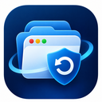
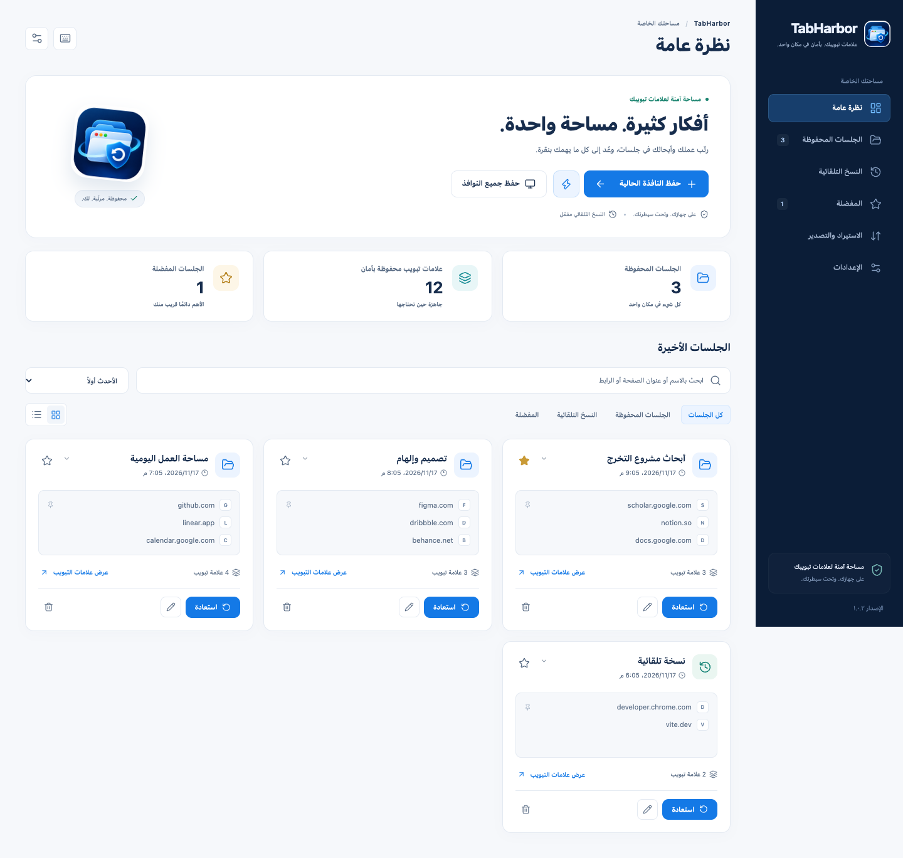
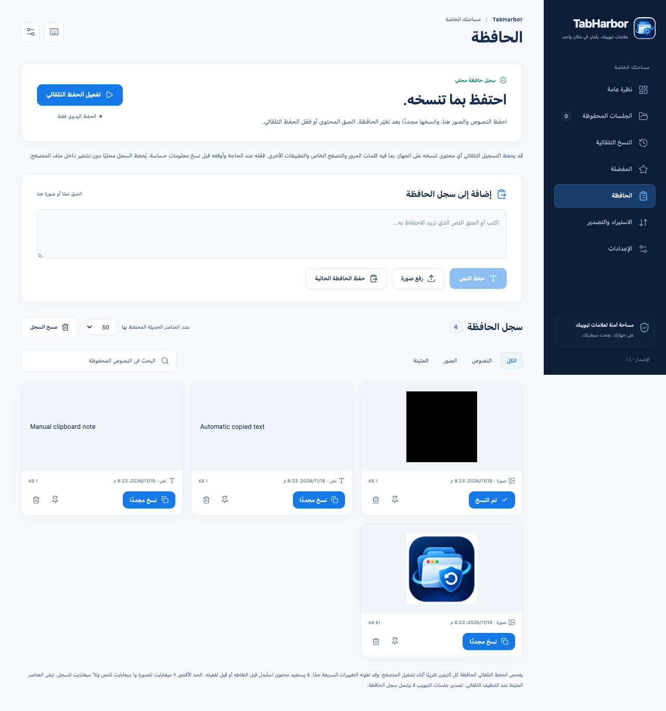
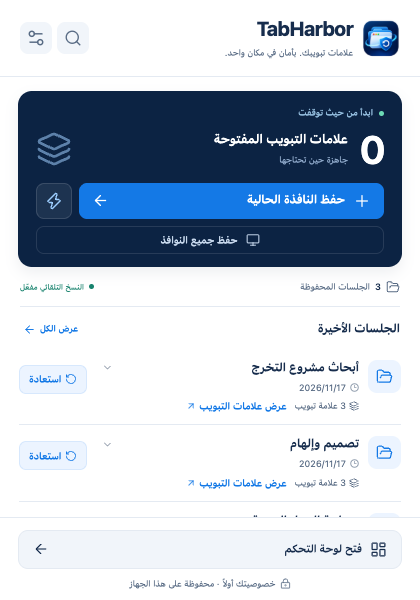

<div align="center">
  
  <h1>TabHarbor</h1>
  <p><strong>علامات تبويبك. بأمان في مكان واحد.</strong><br>Your Tabs. Safe in One Place.</p>
  <p>إضافة لـ <strong>Google Chrome</strong> و<strong>Microsoft Edge</strong><br>جلسات تبويب مرتّبة، نسخ احتياطي تلقائي، وحافظة نصوص وصور اختيارية.</p>
  <p><a href="https://github.com/turky015-oss/TabHarbor/releases/latest">تحميل أحدث إصدار</a> · <a href="#التثبيت">شرح التثبيت</a> · <a href="PRIVACY.md">الخصوصية</a> · <a href="DEVELOPMENT.md">Development guide</a></p>
</div>

## تحميل الإضافة

الإصدار الحالي: **1.1.0** — للمتصفحات المكتبية Chrome وEdge، الإصدار 120 أو أحدث.

| المتصفح | ملف التثبيت |
| --- | --- |
| Google Chrome | [تحميل TabHarbor لـChrome](https://github.com/turky015-oss/TabHarbor/releases/download/v1.1.0/tabharbor-chrome-1.1.0.zip) |
| Microsoft Edge | [تحميل TabHarbor لـEdge](https://github.com/turky015-oss/TabHarbor/releases/download/v1.1.0/tabharbor-edge-1.1.0.zip) |

التحميل من GitHub والتثبيت يدوي بوضع المطوّر. الإضافة لم تُنشر حاليًا في متجري Chrome أو Edge.

يمكن أيضًا تنزيل [نسخة Chrome من ملفات المستودع](https://github.com/turky015-oss/TabHarbor/raw/refs/heads/main/downloads/tabharbor-chrome-1.1.0.zip) أو [نسخة Edge](https://github.com/turky015-oss/TabHarbor/raw/refs/heads/main/downloads/tabharbor-edge-1.1.0.zip).

## ماذا تقدم TabHarbor؟

- **حفظ الجلسات:** احفظ تبويبات النافذة الحالية أو جميع النوافذ العادية، مع اسم وتاريخ وترتيب التبويبات وحالة تثبيتها.
- **استعادة مرنة:** افتح جلسة كاملة في نوافذ جديدة أو النافذة الحالية، أو استعد صفحات تختارها. تبقى الجلسة محفوظة بعد الاستعادة.
- **نسخ احتياطي تلقائي:** لقطات عند تغيّر التبويبات، مع سجل قابل لتحديد العدد؛ تُحمى الجلسات اليدوية والمفضلة من التنظيف التلقائي.
- **تنظيم وبحث:** مفضلة، إعادة تسمية، معاينة قابلة للفتح، تصفية، بحث بالاسم أو العنوان أو الرابط، وعرض بطاقات أو قائمة.
- **حفظ سريع:** زر البرق يحفظ النافذة مباشرة باسم يتضمن الوقت والتاريخ.
- **حافظة نصوص وصور:** حفظ يدوي باللصق والرفع، أو تسجيل تلقائي اختياري، ثم معاينة ونسخ مجددًا وتثبيت وتنزيل وبحث.
- **نسخ الجلسات ونقلها:** استيراد وتصدير JSON مع فحص المحتوى وإضافة الجلسات دون استبدال الموجودة.
- **عربي وإنجليزي:** اتجاه RTL للعربية، ومظهر فاتح أو داكن أو حسب النظام.

## صور من الإضافة

الصور من تشغيل الإضافة ببيانات توضيحية للاختبار.

### لوحة التحكم



### الحافظة: نصوص وصور



<details>
<summary>نافذة الإضافة الصغيرة</summary>



</details>

## التثبيت

1. حمّل ملف ZIP المناسب لمتصفحك من روابط التحميل أعلاه.
2. فك الضغط واحتفظ بالمجلد في مكان ثابت على جهازك.
3. افتح صفحة الإضافات:
   - **Chrome:** اكتب `chrome://extensions` في شريط العنوان.
   - **Edge:** اكتب `edge://extensions` في شريط العنوان.
4. فعّل **وضع المطوّر — Developer mode**.
5. اضغط **تحميل إضافة غير مضغوطة — Load unpacked**.
6. اختر **المجلد الذي يحتوي مباشرةً على ملف `manifest.json`**، ثم اضغط **Select / اختيار**.
7. من قائمة الإضافات بجوار شريط العنوان، ثبّت TabHarbor على شريط الأدوات وافتحها.

لتغيير اللغة: **Settings → Language → العربية**.

## التحديث مع الاحتفاظ ببياناتك

1. حمّل الإصدار الجديد وفك الضغط.
2. انسخ ملفات البناء الجديدة إلى **مجلد الإضافة المثبّت نفسه**.
3. افتح صفحة الإضافات واضغط **↻ إعادة تحميل — Reload** على TabHarbor.

احتفظ بالتثبيت الحالي؛ إزالة الإضافة قد تحذف بياناتها المحلية. نقلها إلى مجلد آخر قد ينشئ تثبيتًا منفصلًا ببيانات مختلفة.

## استخدام الحافظة

افتح **الحافظة** من القائمة الجانبية، أو من زر الحافظة في نافذة الإضافة.

- للحفظ اليدوي: اكتب نصًا واضغط **حفظ النص**، أو الصق صورة، أو استخدم **رفع صورة**.
- لحفظ المحتوى الحالي: اضغط **حفظ الحافظة الحالية**، ثم امنح إذن القراءة عند طلبه.
- للحفظ التلقائي: اضغط **تفعيل الحفظ التلقائي** ووافق على الإذن. يبقى متوقفًا افتراضيًا حتى تختار تشغيله.
- للرجوع إلى عنصر: اضغط **نسخ مجددًا** ثم الصقه حيث تريد. يتوفر أيضًا التثبيت والتنزيل والمعاينة والحذف بتأكيد.

**حدود مهمة:**

- يفحص التسجيل التلقائي الحافظة كل ثانيتين تقريبًا أثناء تشغيل المتصفح. قد تفوته التغييرات السريعة جدًا، ولا يسترجع محتوى استُبدل قبل التقاطه أو قبل تفعيل الميزة.
- حافظة الجهاز قد تتضمن محتوى من تطبيقات أخرى أو نوافذ خاصة أو مدير كلمات مرور؛ لا يمكن تحديد المصدر بشكل موثوق. أوقف التسجيل قبل نسخ معلومات حساسة.
- السجل محلي وغير مشفّر داخل ملف المتصفح. لا يُرسل إلى خادم، لكنه متاح لمن يستطيع الوصول إلى ملف المتصفح.
- الحد الأقصى للنص 1 MB، وللصورة 8 MB و32 مليون بكسل. تُحوّل الصور محليًا إلى PNG. ميزانية السجل 64 MB للمحتوى المحفوظ وصوره المصغرة.
- يُحتفظ افتراضيًا بآخر 50 عنصرًا غير مثبّت، ويمكن اختيار 10–200 عنصر. تبقى العناصر المثبّتة عند التنظيف التلقائي ضمن حد المساحة.
- تصدير جلسات التبويب بصيغة JSON لا يشمل سجل الحافظة؛ نزّل العناصر المطلوبة بصورة منفردة.

## الخصوصية والأذونات

لا حساب مطلوب، ولا تحليلات أو إعلانات أو خادم خلفي أو طلب صلاحية لجميع المواقع. لا تفحص الإضافة محتوى الصفحات أو ملفات تعريف الارتباط. تُستثنى النوافذ الخاصة من **جلسات التبويب**؛ أما الحافظة الاختيارية فتقرأ حافظة الجهاز بالنطاق الموضح أعلاه.

| الإذن | السبب |
| --- | --- |
| `tabs` | قراءة بيانات التبويبات وترتيبها وحفظها واستعادتها. |
| `storage` | تخزين الجلسات والتفضيلات محليًا. |
| `alarms` | جدولة اللقطات التلقائية وإعادة تهيئة المهام بعد سكون العامل الخلفي. |
| `clipboardRead` — اختياري | قراءة الحافظة بطلبك أو بعد تفعيل التسجيل التلقائي. |
| `clipboardWrite` — اختياري | نسخ عنصر محفوظ مجددًا إلى حافظة الجهاز. |
| `offscreen` — اختياري | تشغيل مستند خفي مخصص للحافظة أثناء التسجيل التلقائي. |

راجع [سياسة الخصوصية](PRIVACY.md).

## اختصارات سريعة

| الاختصار | الوظيفة |
| --- | --- |
| `/` | فتح البحث أو التركيز عليه. |
| `N` | بدء حفظ جلسة النافذة الحالية. |
| `Enter` | تأكيد اسم الجلسة في نافذة الحفظ. |
| `Esc` | إغلاق النافذة أو الخروج من البحث. |
| `?` | عرض مساعدة الاختصارات. |

## للمطورين

المشروع مبني بـTypeScript وReact وVite وTailwind، ويستخدم Manifest V3. الشيفرة مشتركة بين Chrome وEdge.

```sh
npm ci
npm run build
npm test
npx playwright install chromium
npm run test:e2e
```

تتوفر تعليمات التطوير والتجارب اليدوية في [DEVELOPMENT.md](DEVELOPMENT.md)، وسجل التغييرات في [CHANGELOG.md](CHANGELOG.md).

تم اجتياز **42 اختبار وحدة**، بالإضافة إلى اختبارات تشغيل فعلية للجلسات والحافظة والتفاعلات في Chrome for Testing وMicrosoft Edge. اختبار الحافظة الآلي يمنح الأذونات مسبقًا في نسخة اختبار معزولة؛ نافذة طلب الإذن الأصلية تحتاج الفحص اليدوي الموضح في دليل التطوير. لا تعني هذه النتائج اعتماد الإضافة من متاجر المتصفحات.

## الدعم

للإبلاغ عن مشكلة أو اقتراح تحسين: [افتح Issue](https://github.com/turky015-oss/TabHarbor/issues).

---

## English overview

**TabHarbor** is a local-first desktop Chrome and Edge extension for saving, organizing, backing up and restoring tab sessions, plus optional text/image clipboard history. Arabic RTL and English, light/dark themes, favorites, search, session previews, JSON session import/export and quick save are included.

Download a browser ZIP from [Releases](https://github.com/turky015-oss/TabHarbor/releases/latest), extract it to a permanent folder, enable **Developer mode** on your browser's Extensions page, choose **Load unpacked**, and select the folder containing `manifest.json`. This is a manually installed extension, not a store listing.

Clipboard monitoring is off by default and requests optional permissions only when activated. It samples the system clipboard about every two seconds while the browser is running and cannot recover items overwritten before capture. Clipboard history may contain sensitive copies from other apps or private browsing; pause it before copying secrets. Stored data is local and unencrypted. See [Privacy](PRIVACY.md) and the [development guide](DEVELOPMENT.md) for details.

Created by [turky015-oss](https://github.com/turky015-oss).
